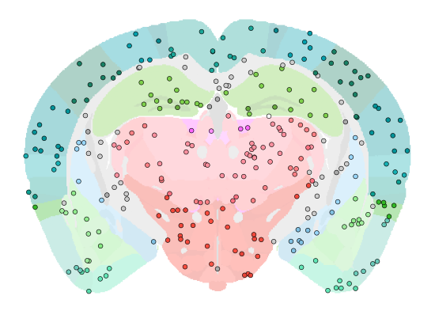
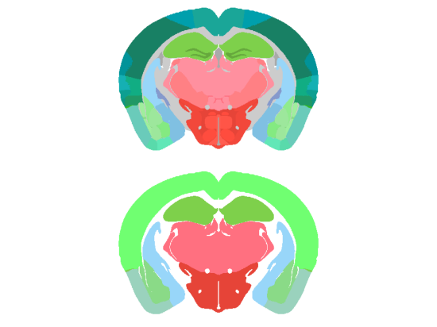
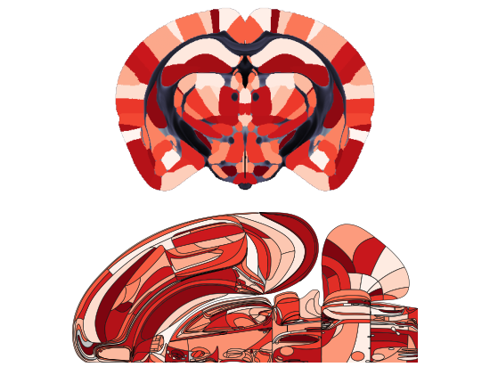
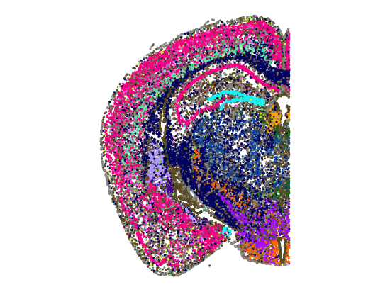
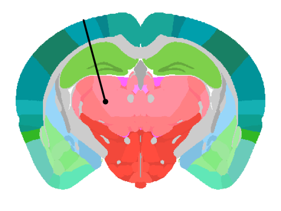
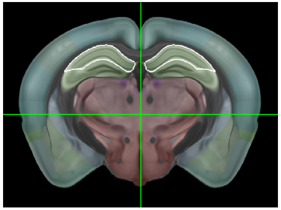

::: {.hero}
::: {.tagline}
`iblatlas` is a Python package from the International Brain Laboratory for working with the Allen
mouse brain atlas. Give it coordinates and it tells you which brain region each one is in. Give it
a value per region and it draws it on slices, flat maps or the Swanson map. Because gene
expression, MERFISH cell types, lipids and mesoscale connectivity are already registered to the
same space, any result you have per region can be compared directly with what's known about those
regions.
:::

[Install iblatlas](how-to/install.qmd){.btn .btn-primary .btn-lg}
[Get started](tutorials/from-coordinates-to-a-brain-figure.ipynb){.btn .btn-outline-primary .btn-lg}
:::

## Start from what you have

::: {.grid}

::: {.g-col-12 .g-col-md-6 .g-col-lg-4}
::: {.workflow-card}
::: {.card-img}
{fig-alt="A probe on a coronal slice, each channel coloured by the brain region it is in, with the top channels above the brain in grey"}
:::
::: {.card-body}
### 1. I have points

Cells, probe channels or injection sites. Which brain region is each one in?

- [Convert coordinates from the Allen CCF or a registration tool](how-to/bring-your-own-coordinates.ipynb)
- [Find cortical depth and project onto the flat map](how-to/work-with-cortical-streamlines.ipynb)
- [Coordinates and volumes](explanation/coordinates-and-volumes.qmd)
:::
:::
:::

::: {.g-col-12 .g-col-md-6 .g-col-lg-4}
::: {.workflow-card}
::: {.card-img}
{fig-alt="One coronal slice drawn with the Allen mapping above the coarser Cosmos mapping"}
:::
::: {.card-body}
### 2. I have region names or ids

How do they fit in the hierarchy, and how do I group them into coarser regions such as Beryl or
Cosmos?

- [Convert region ids between mappings](how-to/remap-region-ids.ipynb)
- [Navigate the brain region hierarchy](how-to/navigate-the-region-hierarchy.ipynb)
- [The brain region hierarchy](explanation/brain-region-hierarchy.qmd)
- [Brain region mappings](explanation/brain-region-mappings.qmd)
:::
:::
:::

::: {.g-col-12 .g-col-md-6 .g-col-lg-4}
::: {.workflow-card}
::: {.card-img}
{fig-alt="Brain regions coloured by value on a coronal slice and on the Swanson flat map"}
:::
::: {.card-body}
### 3. I have results per region

How do I show them? Colour regions on slices or flat maps, or draw values per cell or per voxel.

- [Show one value per region on slices](how-to/plot-values-on-slices.ipynb)
- [Show one value per region on the Swanson map](how-to/plot-on-swanson-flatmap.ipynb)
- [Show one value per region on the dorsal cortex flat map](how-to/plot-on-cortical-flatmap.ipynb)
- [Show values per point or cell on slices](how-to/plot-points-on-slices.ipynb)
- [Show a 3D volume on slices](how-to/plot-volumes-on-slices.ipynb)
:::
:::
:::

::: {.g-col-12 .g-col-md-6 .g-col-lg-4}
::: {.workflow-card}
::: {.card-img}
{fig-alt="One MERFISH section with each cell coloured by its cell class"}
:::
::: {.card-body}
### 4. I have a region of interest

What is already known about it? Gene expression, cell types, lipids and connectivity are
registered to the same space as your data, so they join to it by a coordinate or a region id.

- [From your results to what's known](tutorials/from-your-results-to-whats-known.ipynb)
- [Load gene expression volumes](how-to/load-gene-expression-agea.ipynb)
- [Load MERFISH cell types](how-to/load-merfish.ipynb)
- [Load lipid volumes](how-to/load-lipids.ipynb)
- [Load mesoscale connectivity and the cortico-thalamic hierarchy](how-to/load-mesoscale-connectivity.ipynb)
- [External data in the common space](explanation/external-data-in-the-common-space.qmd)
:::
:::
:::

::: {.g-col-12 .g-col-md-6 .g-col-lg-4}
::: {.workflow-card}
::: {.card-img}
{fig-alt="A tilted probe track on a coronal slice, crossing cortex, hippocampus and thalamus"}
:::
::: {.card-body}
### 5. I want to record from a region

Where does the probe go in, what will it pass through, and where did it end up?

- [Describe a probe insertion and list the regions it crosses](how-to/work-with-probe-insertions.qmd)
- [Atlas spaces and transforms](explanation/atlas-spaces.qmd)
:::
:::
:::

::: {.g-col-12 .g-col-md-6 .g-col-lg-4}
::: {.workflow-card}
::: {.card-img}
{fig-alt="The IBL Atlas GUI's coronal view, with hippocampus outlined and crosshairs marking the other slice positions"}
:::
::: {.card-body}
### 6. I want to browse the atlas

Scroll through slices, search the region tree, and see which region is under the cursor, in a
desktop application.

- [Explore the atlas in the IBL Atlas GUI](how-to/explore-the-atlas-in-the-gui.qmd)
:::
:::
:::

:::

## Core concepts

::: {.grid}

::: {.g-col-12 .g-col-md-6 .g-col-lg-3}
::: {.tile}
[Coordinates and volumes](explanation/coordinates-and-volumes.qmd)

Metres, a bregma origin, axis order and signs.
:::
:::

::: {.g-col-12 .g-col-md-6 .g-col-lg-3}
::: {.tile}
[The brain region hierarchy](explanation/brain-region-hierarchy.qmd)

The tree of regions that mappings collapse.
:::
:::

::: {.g-col-12 .g-col-md-6 .g-col-lg-3}
::: {.tile}
[Brain region mappings](explanation/brain-region-mappings.qmd)

Allen, Beryl, Cosmos and Swanson.
:::
:::

::: {.g-col-12 .g-col-md-6 .g-col-lg-3}
::: {.tile}
[Data downloads and caching](explanation/data-downloads-and-caching.qmd)

Where the atlas data is stored and when it is downloaded.
:::
:::

:::
