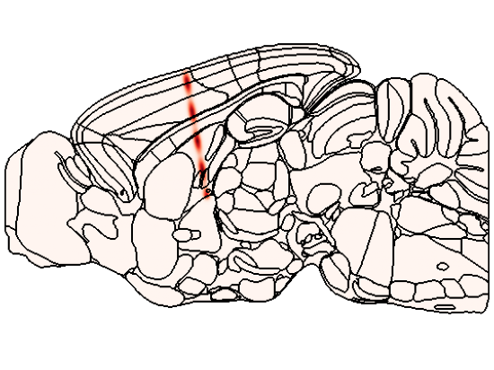
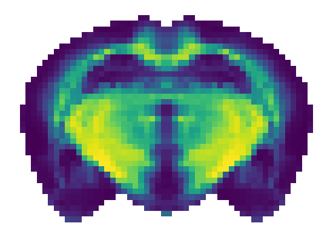

::: {.hero}
::: {.tagline}
`iblatlas` is a Python package from the International Brain Laboratory for working with the
mouse brain in the Allen Common Coordinate Framework: converting coordinates, navigating brain
regions, and plotting results on slices and flat maps.
:::

[Install iblatlas](how-to/install.qmd){.btn .btn-primary .btn-lg}
[Start the tutorial](tutorials/working-with-the-atlas.ipynb){.btn .btn-outline-primary .btn-lg}

::: {.note}
The tutorial tours the atlas object: the image and label volumes, brain regions and the
hierarchy, and the coordinate systems.
:::
:::

## What you can do

::: {.grid}

::: {.g-col-12 .g-col-md-6 .g-col-lg-4}
::: {.workflow-card}
::: {.card-img}
{fig-alt="A probe track plotted on a sagittal slice"}
:::
::: {.card-body}
### Probes and points

Convert your coordinates to atlas space, look up the region at each point, and plot probes and
clusters on slices, coloured by a value.

- [Convert your own coordinates to atlas space](how-to/bring-your-own-coordinates.ipynb)
- [Work with probe insertions](how-to/work-with-probe-insertions.qmd)
- [Plot points on slices](how-to/plot-points-on-slices.ipynb)
:::
:::
:::

::: {.g-col-12 .g-col-md-6 .g-col-lg-4}
::: {.workflow-card}
::: {.card-img}
{fig-alt="Brain regions coloured by value on a coronal slice"}
:::
::: {.card-body}
### Region values

Colour regions by a value, one per region, on slices or on the cortical, Swanson and circular
flat maps.

- [Plot values on slices](how-to/plot-values-on-slices.ipynb)
- [Plot on the cortical flat map](how-to/plot-on-cortical-flatmap.ipynb)
- [Plot on the Swanson flat map](how-to/plot-on-swanson-flatmap.ipynb)
- [Plot on the circular flat map](how-to/plot-on-circular-flatmap.ipynb)
:::
:::
:::

::: {.g-col-12 .g-col-md-6 .g-col-lg-4}
::: {.workflow-card}
::: {.card-img}
{fig-alt="A volume plotted on a coronal slice"}
:::
::: {.card-body}
### Volumes and 3D meshes

Plot a volume with one value per voxel on coronal, sagittal and horizontal slices, at any atlas
resolution, or display the region meshes in 3D.

- [Plot a volume on slices](how-to/plot-volumes-on-slices.ipynb)
- [Display 3D region meshes](how-to/display-3d-meshes.qmd)
- [Convert Allen meshes to GLB](how-to/convert-allen-meshes-to-glb.qmd)
:::
:::
:::

::: {.g-col-12 .g-col-md-6 .g-col-lg-4}
::: {.workflow-card}
::: {.card-img}
{fig-alt="One coronal slice drawn with the Allen, Beryl and Cosmos mappings"}
:::
::: {.card-body}
### Regions, mappings and atlas spaces

Look up regions in the Allen hierarchy, remap them to the coarser Beryl and Cosmos mappings, and
move coordinates between atlas spaces.

- [Remap region ids](how-to/remap-region-ids.ipynb)
- [Brain region mappings](explanation/brain-region-mappings.qmd)
- [Atlas spaces and transforms](explanation/atlas-spaces.qmd)
:::
:::
:::

::: {.g-col-12 .g-col-md-6 .g-col-lg-4}
::: {.workflow-card}
::: {.card-img}
{fig-alt="Lipid volume data on coronal and sagittal slices"}
:::
::: {.card-body}
### External data in the common space

Gene expression, MERFISH cell types, lipids, mesoscale connectivity and cortical streamlines
are registered to the same space, so they join to your data by a coordinate or an Allen region
id.

- [Gene expression](how-to/load-gene-expression-agea.ipynb)
- [MERFISH](how-to/load-merfish.ipynb)
- [Lipids](how-to/load-lipids.ipynb)
- [Mesoscale connectivity](how-to/load-mesoscale-connectivity.ipynb)
- [Cortical streamlines](how-to/work-with-cortical-streamlines.ipynb)
- [External data in the common space](explanation/external-data-in-the-common-space.qmd)
:::
:::
:::

::: {.g-col-12 .g-col-md-6 .g-col-lg-4}
::: {.workflow-card}
::: {.card-img}
{fig-alt="The IBL Atlas GUI showing a coronal slice with a region tooltip"}
:::
::: {.card-body}
### Explore the atlas in the GUI

Browse the atlas in coronal, sagittal and horizontal slices, hover for region names and pick
regions from the tree, without writing code.

- [Explore the atlas in the IBL Atlas GUI](how-to/explore-the-atlas-in-the-gui.qmd)
:::
:::
:::

:::

## Core concepts

::: {.grid}

::: {.g-col-12 .g-col-md-6 .g-col-lg-3}
::: {.tile}
[Coordinates and volumes](explanation/coordinates-and-volumes.qmd)

Metres, a bregma origin, axis order and signs.
:::
:::

::: {.g-col-12 .g-col-md-6 .g-col-lg-3}
::: {.tile}
[The brain region hierarchy](explanation/brain-region-hierarchy.qmd)

The tree of regions that mappings collapse.
:::
:::

::: {.g-col-12 .g-col-md-6 .g-col-lg-3}
::: {.tile}
[Brain region mappings](explanation/brain-region-mappings.qmd)

Allen, Beryl, Cosmos and Swanson.
:::
:::

::: {.g-col-12 .g-col-md-6 .g-col-lg-3}
::: {.tile}
[Data downloads and caching](explanation/data-downloads-and-caching.qmd)

Where the atlas data is stored and when it is downloaded.
:::
:::

:::
